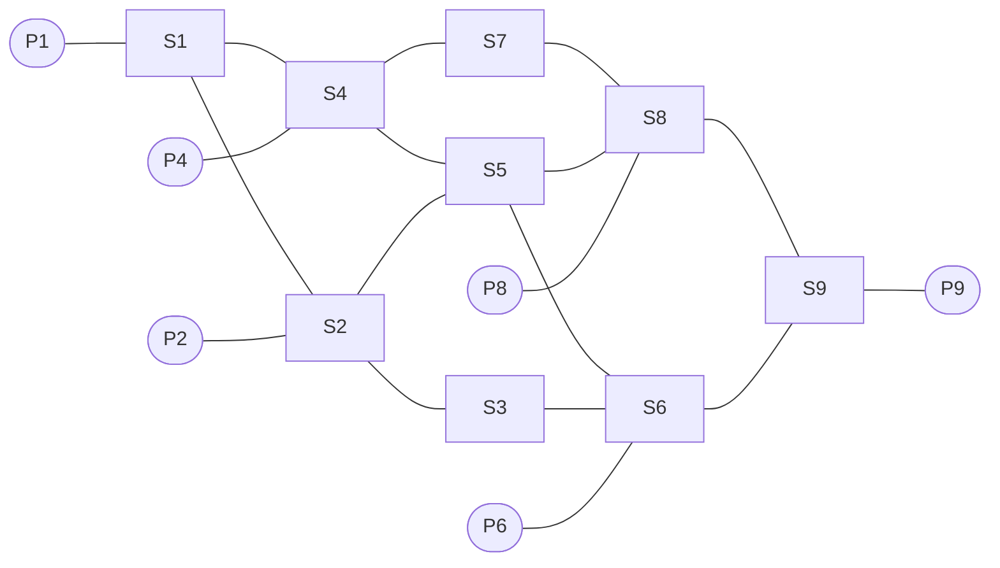
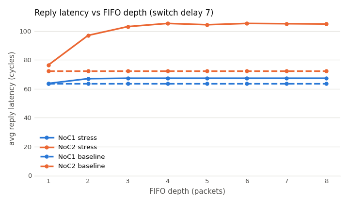

# vhdl-noc-mesh

A parametric 3×3 mesh Network-on-Chip in VHDL, with a self-checking test suite and a
NoC1-vs-NoC2 traffic study.

[](https://github.com/Aref-Ghoreishi/vhdl-noc-mesh/actions/workflows/ci.yml)
[](LICENSE)

## Overview

A behavioral VHDL-2008 model for traffic evaluation (not synthesizable RTL). Two masters
(P1, P9) send requests from text files to four slaves (P2: sort ascending, P4: parity,
P6: sort descending, P8: checksum). Each slave sends its result to a fixed master, and
every packet carries a hop count and a timestamp, so each reply can be timed end to end.



NoC2 is the same mesh without S3 and S7.

## Features

- Five-port switches with circular input FIFOs, static routing tables and per-output
  round-robin arbitration
- FIFO depth, switch delay and topology (NoC1 / NoC2) are generics
- Valid/ready backpressure on every link; nothing is ever dropped
- Hop count, request-to-reply latency and per-FIFO occupancy instrumentation
- Python golden model that checks every packet of every run
- Parallel sweep and result plots from one Makefile

## Quick start

Needs GHDL 5.x, make and Python 3 (matplotlib for `make results`).

```sh
make test      # unit + system tests, route trace, golden checker
make sweep     # 256 runs: FIFO depth 1-8 x delay 0-7 x NoC1/NoC2 x 2 data sets
make results   # sweep, then results/results.csv and figures
```

## Results

Switch delay 7, from [`results/results.csv`](results/results.csv). Latency is the
average number of cycles from a request's issue to its reply; *done* is the cycle the
last packet arrived.

| data set | FIFO depth | latency NoC1 / NoC2 | done NoC1 / NoC2 | S5 max FIFO NoC1 / NoC2 |
|---|---:|---:|---:|---:|
| baseline | 2 | 63.5 / 72.3 | 179 / 195 | 2 / 2 |
| baseline | 8 | 63.5 / 72.3 | 179 / 195 | 2 / 3 |
| stress | 2 | 67.0 / 96.9 | 459 / 537 | 2 / 2 |
| stress | 8 | 67.3 / 104.8 | 459 / 537 | 2 / 8 |



Without S3 and S7, NoC2 sends 10 of the 14 traffic flows through S5 instead of 6, and S5
forwards 140 packets instead of 100 on the stress set. Under that load NoC2 is slower
(96.9 vs 67.0 cycles, finishing at cycle 537 vs 459). Deeper FIFOs don't fix it: at
depth 8, S5's FIFOs fill completely and latency rises to 104.8 cycles.

## Verification

- Unit tests for the FIFO, switch (routing, fairness, backpressure, FIFO full, random
  traffic), slaves and masters, plus system tests on both topologies and data sets
- 256-run sweep, every packet checked against a Python golden model; run in CI
- Regression against the original ModelSim logs: 12/24 replies identical, the other 12
  changed by the `valid_size` fix, hop counts 24/24
- Valid/ready handshake checkers on every link
- Bugs fixed: switch deadlock, packet loss in the slave, FIFO corner cases, forward
  schedule, `valid_size` conformance

## Repository layout

```
rtl/        package, FIFO, switch, master, slave, top level
tb/         unit, system and common (checker) testbenches
data/       baseline and stress inputs, original ModelSim logs
scripts/    golden checker, route trace, sweep, analysis, testbench runner
results/    results.csv and figures
```

Developed for ECE 846 – Digital System Design with HDLs, University of Tehran.

MIT License © 2026 Aref Ghoreishi
